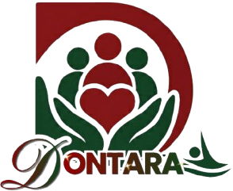

<div align="center">



# DONTARA

**Donasi Ta'awun Untirta**

Platform donasi kolektif berprinsip syariah untuk sivitas akademika Universitas Sultan Ageng Tirtayasa, dengan pelacakan dana yang transparan berbasis blockchain.


</div>

---

## Tentang Proyek

**DONTARA** adalah prototipe aplikasi donasi yang dirancang agar infak dan sedekah di lingkungan kampus berjalan **amanah, transparan, dan berdampak nyata**. Setiap donasi dicatat dengan nomor transaksi dan hash, setiap kampanye diverifikasi, dan laporan penyaluran dana dipublikasikan agar donatur bisa memantau ke mana dananya pergi.

> **Catatan status:** repositori ini adalah **prototipe antarmuka (front-end)**. Seluruh data (kampanye, transaksi, hash, papan peringkat) masih berupa data contoh di dalam kode, dan proses pembayaran hanya simulasi. Belum ada koneksi ke jaringan blockchain, payment gateway, maupun database sungguhan.

## Fitur

| Halaman | Fungsi |
| --- | --- |
| **Beranda** | Ringkasan dana, kampanye unggulan, voting program berikutnya, dan pencapaian pengguna |
| **Donasi** | Pilih program, jenis (infak atau sedekah), nominal, dan metode bayar: QRIS, transfer bank syariah, atau e-wallet |
| **Kampanye** | Daftar program donasi beserta progres dana, jumlah donatur, dan sisa waktu |
| **Detail Kampanye** | Linimasa perkembangan program dan laporan penyaluran dana |
| **Transparansi Dana** | Alur dana dari donasi diterima sampai laporan dipublikasikan, plus rekap dana masuk dan keluar |
| **Riwayat Donasi** | Daftar transaksi lengkap dengan status dan hash transaksi |
| **Akad & Prinsip Syariah** | Penjelasan akad, prinsip ta'awun, dan syarat verifikasi kampanye |
| **Komunitas** | Interaksi sesama donatur dan sivitas akademika |
| **Gamifikasi** | Poin, lencana (badge), dan papan peringkat, dengan opsi donasi anonim |
| **Profil & Verifikasi** | Data pengguna dan status verifikasi akun |
| **Panel Admin** | Peninjauan dan persetujuan kampanye yang diajukan |

## Teknologi

- [React 18](https://react.dev/) dan [TypeScript](https://www.typescriptlang.org/) (TSX)
- [Vite 6](https://vite.dev/) sebagai alat build dan development server
- [Tailwind CSS 4](https://tailwindcss.com/) untuk gaya tampilan
- [Radix UI](https://www.radix-ui.com/) dan komponen bergaya shadcn/ui di `src/app/components/ui`
- [Recharts](https://recharts.org/) untuk grafik
- [Lucide React](https://lucide.dev/) untuk ikon
- Font [Plus Jakarta Sans](https://fonts.google.com/specimen/Plus+Jakarta+Sans) dan [JetBrains Mono](https://fonts.google.com/specimen/JetBrains+Mono)

Desain awal dibuat di [Figma](https://www.figma.com/design/bO47nGJIcVQwZM7dSJ3mBc/Aplikasi-Donasi-Berbasis-Blockchain).

## Memulai

### Prasyarat

- [Node.js](https://nodejs.org/) versi **20 atau lebih baru** (cek dengan `node -v`)
- npm (sudah ikut terpasang bersama Node.js)

### Instalasi

```bash
# 1. Unduh repositori
git clone https://github.com/azizbinsam/dontara.git
cd dontara

# 2. Pasang dependensi
npm install

# 3. Jalankan server pengembangan
npm run dev
```

Buka alamat yang muncul di terminal, biasanya `http://localhost:5173`.

### Perintah yang tersedia

| Perintah | Fungsi |
| --- | --- |
| `npm run dev` | Menjalankan server pengembangan dengan muat ulang otomatis |
| `npm run build` | Membuat versi produksi di folder `dist/` |
| `npx vite preview` | Menjalankan hasil build secara lokal untuk dicek sebelum deploy |

## Struktur Proyek

```
dontara/
├── index.html                 # Pintu masuk HTML (termasuk favicon)
├── package.json
├── vite.config.ts
└── src/
    ├── main.tsx               # Titik awal aplikasi React
    ├── app/
    │   ├── App.tsx            # Seluruh halaman, data contoh, dan navigasi
    │   └── components/
    │       └── ui/            # Komponen UI dasar (shadcn/ui + Radix)
    ├── assets/                # Logo DONTARA dan logo Untirta
    ├── imports/               # Gambar referensi prototipe dari Figma
    └── styles/                # Tailwind, tema, dan font
```

Navigasi antarhalaman saat ini memakai state React biasa (bukan router), jadi alamat URL tidak berubah saat berpindah halaman.

## Rencana Pengembangan

- [ ] Memecah `App.tsx` menjadi komponen dan halaman terpisah
- [ ] Menambah routing dengan URL per halaman
- [ ] Menghubungkan pencatatan transaksi ke jaringan blockchain
- [ ] Integrasi payment gateway (QRIS, transfer, e-wallet)
- [ ] Backend dan database untuk akun, kampanye, dan riwayat donasi
- [ ] Autentikasi pengguna dan peran admin
- [ ] Pengujian otomatis

## Kontribusi

Saran dan perbaikan sangat diterima. Untuk berkontribusi:

1. Fork repositori ini
2. Buat cabang baru: `git checkout -b fitur/nama-fitur`
3. Commit perubahan: `git commit -m "Tambah nama-fitur"`
4. Push ke cabang: `git push origin fitur/nama-fitur`
5. Buka Pull Request

## Pengembang

Dikembangkan oleh [@azizbinsam](https://github.com/azizbinsam) untuk lingkungan Universitas Sultan Ageng Tirtayasa.

## Lisensi

Lisensi belum ditentukan. Sebelum repositori ini dipakai atau disebarkan pihak lain, tambahkan file `LICENSE` sesuai kebutuhan (misalnya MIT).